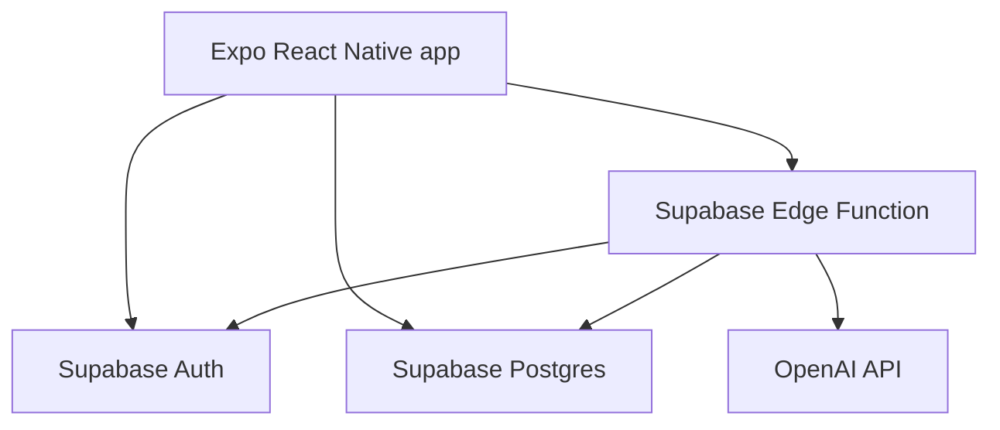

# Architecture Overview

## Stack

- Expo
- React Native
- TypeScript
- Supabase Auth
- Supabase Postgres
- Supabase Row Level Security
- Supabase Edge Functions
- OpenAI API through Edge Functions only

## High-Level Flow

## App Responsibilities

The mobile app handles:

- Authentication UI.
- One-tap record creation.
- Optional detail editing.
- Daily and recent record display.
- Report request UI.
- Rendering AI report text and source links.

The app must not contain:

- OpenAI API keys.
- Supabase service role keys.
- Medical reference generation logic.

## Supabase Responsibilities

Supabase handles:

- User authentication.
- Allowed-user access control.
- Health log storage.
- Approved reference source storage.
- RLS enforcement for all user-owned records.

Every user-owned table must include a `user_id` column and RLS policies that restrict access to the owning authenticated user.

## Edge Function Responsibilities

The AI report Edge Function handles:

- Verifying the Supabase session.
- Rejecting unapproved users.
- Loading only the calling user's records.
- Loading only approved reference sources.
- Calling OpenAI with a constrained prompt.
- Returning report sections with source links.

The Edge Function is the only place where OpenAI credentials may exist.

## Initial Data Model

Core tables:

- `profiles`: one row per allowed user.
- `bathroom_logs`: urine, bowel movement, or both.
- `reference_sources`: approved or candidate reference links.
- `ai_reports`: optional saved report outputs.

The MVP can start without saving generated reports if that keeps implementation simpler. In that case, reports are generated on demand and logs remain the source of truth.

## Deployment Notes

- GitHub repository starts private.
- `main` is the default branch.
- Feature work uses `feature/...` branches.
- CI should run lint, typecheck, and tests.
- Secrets are configured outside Git.

