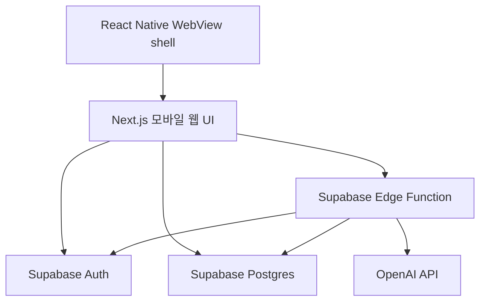

# 아키텍처 개요

## 기술 스택

- Next.js
- React
- React Native WebView shell
- TypeScript
- Supabase Auth
- Supabase Postgres
- Supabase Row Level Security
- Supabase Edge Functions
- Edge Function을 통한 OpenAI API 호출

## 전체 흐름

## Next.js 앱의 책임

Next.js 모바일 웹 UI가 담당하는 것:

- 인증 UI.
- 원탭 기록 생성.
- 선택적 상세 정보 수정.
- 일별 및 최근 기록 표시.
- 리포트 요청 UI.
- AI 리포트 텍스트와 출처 링크 렌더링.

Next.js 앱에 포함하면 안 되는 것:

- OpenAI API key.
- Supabase service role key.
- 의학 참고 기준 생성 로직.

운영 사용은 React Native WebView 안에서 하는 것을 기본으로 한다. 다만 개발 환경에서는 Next.js 앱을 브라우저에서 직접 열 수 있어야 한다.

## React Native shell의 책임

React Native shell은 얇게 유지한다.

담당하는 것:

- WebView 로드.
- 앱 아이콘과 스플래시.
- safe area와 기본 앱 chrome.
- 외부 링크 열기 제어.
- 추후 생체인증, 앱 잠금, push 알림 같은 native 기능 연결.

담당하지 않는 것:

- 건강 기록 비즈니스 로직.
- Supabase 데이터 접근 로직의 중복 구현.
- AI 리포트 생성.
- WebView와 복잡한 상태 동기화.

WebView 통신은 꼭 필요한 native 기능에 한해 최소화한다.

## Supabase의 책임

Supabase가 담당하는 것:

- 이메일 + 비밀번호 기반 사용자 인증.
- 허용 사용자 접근 제어.
- 건강 기록 저장.
- 승인된 참고 출처 저장.
- 모든 사용자 소유 기록에 대한 RLS 적용.

모든 사용자 소유 테이블은 `user_id` 컬럼을 가져야 하며, RLS 정책은 인증된 사용자 본인의 행만 접근하도록 제한해야 한다.

## Edge Function의 책임

AI 리포트 Edge Function이 담당하는 것:

- Supabase 세션 검증.
- 승인되지 않은 사용자 거부.
- 호출한 사용자의 기록만 조회.
- 승인된 참고 출처만 조회.
- 제한된 프롬프트로 OpenAI 호출.
- 리포트 섹션과 출처 링크 반환.

OpenAI 자격 증명은 Edge Function에만 존재할 수 있다.

## 초기 데이터 모델

핵심 테이블:

- `allowed_users`: 앱 접근이 허용된 이메일 목록.
- `profiles`: 허용 사용자별 1개 행.
- `health_records`: 새 5분류 기록의 장기 source of truth. 수면, 음식, 화장실, 운동, 컨디션 기록을 공통 컬럼과 `details jsonb`로 시작한다.
- `bathroom_logs`: 기존 소변/대변 MVP 기록 테이블. 새 기록 모델로 전환할 때 유지, 변환, 대체 범위를 다시 결정한다.
- `reference_sources`: 승인 또는 후보 상태의 참고 출처 링크.
- `ai_reports`: 선택적으로 저장하는 리포트 결과.

구현을 단순하게 유지하려면 MVP에서는 생성된 리포트를 저장하지 않아도 된다. 이 경우 리포트는 요청 시 생성하고, 기록이 source of truth로 남는다.

`health_records.details`의 분류별 JSON 구조는 각 기록 페이지를 만들면서 확정한다. 구조 변경은 `details_version`으로 추적하고, 통계나 검색이 중요해진 분류는 이후 별도 상세 테이블로 분리할 수 있다.

## 배포 메모

- GitHub 저장소는 private으로 시작한다.
- 기본 브랜치는 `main`이다.
- 기능 작업은 `feature/...` 브랜치를 사용한다.
- CI는 Next.js와 React Native shell의 lint, typecheck, test를 실행한다.
- secret은 Git 밖에서 관리한다.
- 실제 사용자는 모바일 앱을 통해 접근한다.
- 개발자는 Next.js dev server를 브라우저에서 직접 열어 UI와 데이터 흐름을 빠르게 확인할 수 있다.
