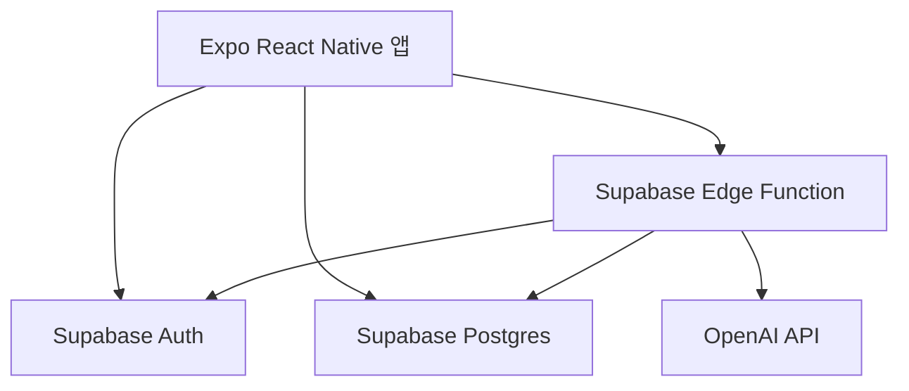

# 아키텍처 개요

## 기술 스택

- Expo
- React Native
- TypeScript
- Supabase Auth
- Supabase Postgres
- Supabase Row Level Security
- Supabase Edge Functions
- Edge Function을 통한 OpenAI API 호출

## 전체 흐름

## 앱의 책임

모바일 앱이 담당하는 것:

- 인증 UI.
- 원탭 기록 생성.
- 선택적 상세 정보 수정.
- 일별 및 최근 기록 표시.
- 리포트 요청 UI.
- AI 리포트 텍스트와 출처 링크 렌더링.

앱에 포함하면 안 되는 것:

- OpenAI API key.
- Supabase service role key.
- 의학 참고 기준 생성 로직.

## Supabase의 책임

Supabase가 담당하는 것:

- 사용자 인증.
- 허용 사용자 접근 제어.
- 건강 기록 저장.
- 승인된 참고 출처 저장.
- 모든 사용자 소유 기록에 대한 RLS 적용.

모든 사용자 소유 테이블은 `user_id` 컬럼을 가져야 하며, RLS 정책은 인증된 사용자 본인의 행만 접근하도록 제한해야 한다.

## Edge Function의 책임

AI 리포트 Edge Function이 담당하는 것:

- Supabase 세션 검증.
- 승인되지 않은 사용자 거부.
- 호출한 사용자의 기록만 조회.
- 승인된 참고 출처만 조회.
- 제한된 프롬프트로 OpenAI 호출.
- 리포트 섹션과 출처 링크 반환.

OpenAI 자격 증명은 Edge Function에만 존재할 수 있다.

## 초기 데이터 모델

핵심 테이블:

- `profiles`: 허용 사용자별 1개 행.
- `bathroom_logs`: 소변, 대변, 둘 다 기록.
- `reference_sources`: 승인 또는 후보 상태의 참고 출처 링크.
- `ai_reports`: 선택적으로 저장하는 리포트 결과.

구현을 단순하게 유지하려면 MVP에서는 생성된 리포트를 저장하지 않아도 된다. 이 경우 리포트는 요청 시 생성하고, 기록이 source of truth로 남는다.

## 배포 메모

- GitHub 저장소는 private으로 시작한다.
- 기본 브랜치는 `main`이다.
- 기능 작업은 `feature/...` 브랜치를 사용한다.
- CI는 lint, typecheck, test를 실행한다.
- secret은 Git 밖에서 관리한다.

